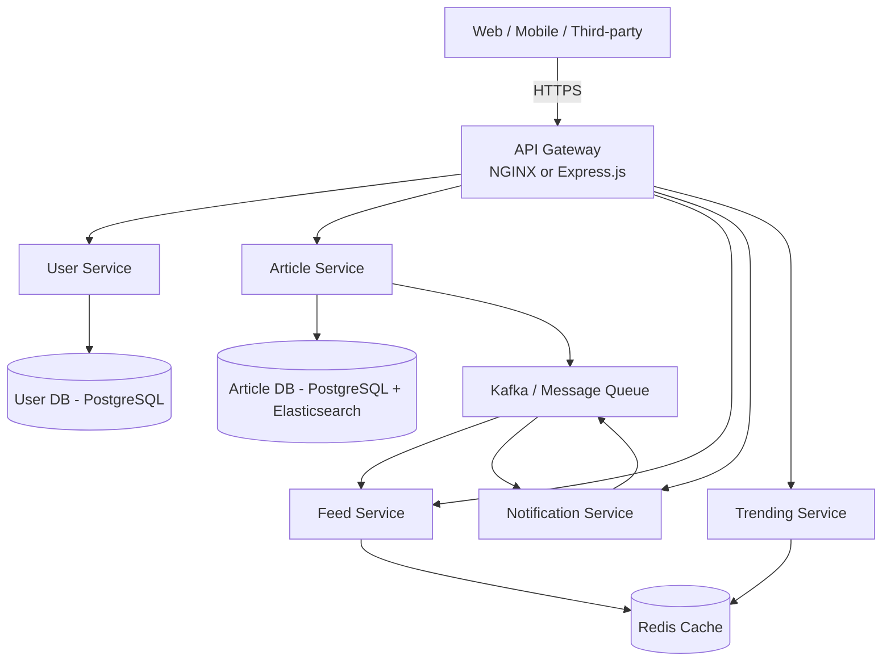

# Personalized News Platform – High-Level System Design

**Round 3 – High-Level System Design Challenge (25 Marks)**

Design of a personalized news platform supporting **millions of users** and continuously changing news content.

## Problem Statement
Build a scalable system for:
- User registration & preferences
- News articles, topics, feeds
- Personalized recommendations
- Notifications & breaking news
- Trending news

## 1. System Architecture

Microservices architecture with API Gateway as single entry point.

### Core Services
| Service | Responsibility |
|---------|----------------|
| **User Service** | Registration, profile, preferences, auth |
| **Article Service** | CRUD for news articles, metadata |
| **Topic Service** | Topic taxonomy, categorization |
| **Feed Service** | Personalized feed generation, ranking |
| **Notification Service** | Push, email, in-app notifications |
| **Trending Service** | Real-time trending calculation |
| **Interaction Service** | Likes, views, shares, comments |

### High-Level Diagram (Mermaid)


**API Gateway** routes traffic (see previous API Gateway design):
- `/api/users/*` → User Service
- `/api/articles/*` → Article Service
- `/api/feed/*` → Feed Service
- `/api/notifications/*` → Notification Service
- `/api/trending` → Trending Service

## 2. REST API Communication

All external communication via REST through the API Gateway. Internal services can use REST or gRPC.

### Key Endpoints

#### Users
- `POST /api/users/register`
- `POST /api/users/login`
- `GET /api/users/me`
- `PUT /api/users/preferences`

#### Articles
- `GET /api/articles/{id}`
- `GET /api/articles?topic=tech&page=1`
- `POST /api/articles` (admin/publisher)

#### Personalized Feed
- `GET /api/feed` → personalized articles based on preferences & interactions

#### Additional API: Get Trending News
- `GET /api/trending?limit=20&window=1h`
  - Returns top articles by views/shares in the last window
  - Cached heavily in Redis

#### Notifications
- `GET /api/notifications`
- `POST /api/notifications/subscribe`

**Communication Flow Example (Get Personalized Feed):**
1. Client → API Gateway (`GET /api/feed`)
2. Gateway authenticates (JWT) → routes to Feed Service
3. Feed Service reads user preferences (User Service or cached)
4. Queries Redis for pre-computed feed or falls back to ranking engine
5. Returns ranked articles

## 3. Database Selection

| Data | Database | Reason |
|------|----------|--------|
| Users, preferences, profiles | **PostgreSQL** | ACID, relational, strong consistency |
| Articles, topics, metadata | **PostgreSQL** + **Elasticsearch** | Relational for writes; Elasticsearch for full-text search & filtering |
| User interactions (views, likes, shares) | **Cassandra** or **DynamoDB** | High write throughput, time-series friendly |
| Personalized feeds & rankings | **Redis** + precomputed in PostgreSQL | Fast reads |
| Notifications history | **MongoDB** or **PostgreSQL** | Flexible schema |
| Trending counters | **Redis** (sorted sets) | Real-time increments & top-N queries |

## 4. Caching Strategy

**Multi-layer caching:**
- **CDN** (CloudFront / Cloudflare) for static assets & public articles
- **Redis** for:
  - Trending news (sorted set: score = views + shares)
  - Popular articles (TTL 5–15 min)
  - User preferences & session
  - Pre-computed personalized feeds (TTL 2–5 min)
  - Frequently accessed topics

**Cache Invalidation:**
- On new article publish → publish event to Kafka → invalidate relevant topic caches & update trending
- Background job refreshes trending every 30–60 seconds

## 5. Messaging Design

**Apache Kafka** (or RabbitMQ / AWS SNS+SQS) as the backbone.

### Topics
- `new-article` – published when a new article is created
- `breaking-news` – high-priority alerts
- `topic-updates` – category or trending changes
- `user-notifications` – personalized notification events
- `interaction-events` – views, likes (for ranking & analytics)

### Consumers
- Feed Service → updates personalized feeds & recommendations
- Notification Service → sends push/email
- Trending Service → increments counters in Redis
- Search Indexer → updates Elasticsearch

**Breaking News Flow:**
1. Editorial publishes breaking article → Article Service writes to DB + publishes to `breaking-news` topic
2. Notification Service consumes → fans out to subscribed users (via topic preferences)
3. Trending Service boosts the article score
4. Feed Service invalidates caches for affected users

## 6. Scalability

**Handling sudden traffic spikes (breaking news):**

1. **API Gateway** – NGINX with rate limiting + horizontal scaling behind a load balancer.
2. **Horizontal scaling** of all stateless services (Kubernetes / ECS).
3. **Caching** – 90%+ of feed and trending reads served from Redis.
4. **Async processing** – all heavy work (notifications, ranking updates, indexing) via Kafka so the request path stays fast.
5. **Database read replicas** + connection pooling.
6. **Circuit breakers** & graceful degradation (serve cached feed if ranking service is slow).
7. **Auto-scaling** policies based on CPU, request rate, and Kafka lag.
8. **CDN** absorbs public article traffic.

**Capacity planning:**
- Redis Cluster for cache
- Kafka with multiple partitions
- PostgreSQL with read replicas + partitioning by date for articles

## Project Structure
```
├── README.md                 # This file (full design)
├── architecture.md           # Detailed diagrams & service interactions
├── api-examples.md           # Sample request/response
├── nginx-gateway.conf       # Sample NGINX API Gateway config
└── express-gateway.js        # Sample Express.js API Gateway
```

---
*Designed for millions of concurrent users with continuous news ingestion and personalized delivery.*
